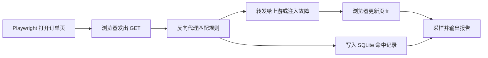

# ChaosKit

ChaosKit 在本地给 API 注入故障，用 Playwright 记录页面如何响应，并输出可重跑的前端容错报告。

[两分钟内的演示](docs/demo.mp4) · [开发记录](PROGRESS.md)

## 先看一个回归

四个订单页在 API 正常时展示相同的订单。固定给 `GET /api/orders/1` 返回 500 后，修复版显示错误提示，点击重试会再次发起请求并恢复订单。旧版会持续转圈，另一版会白屏。报告保留基线、故障和恢复截图，以及代理命中和浏览器网络事件。

| 对照页 | 预期 500 场景得分 | 可观察结果 |
| --- | ---: | --- |
| complete | 100 | 错误提示可见，重试后订单恢复 |
| no-retry | 80 | 错误提示可见，无恢复入口 |
| spinner | 50 | 页面仍可见，持续加载，无错误提示 |
| blank | 0 | 页面在故障窗口内白屏 |

## 启动

```sh
docker compose up --build
```

打开 <http://127.0.0.1:8000>。面板可增改、启停或删除规则，并显示最近 20 条代理记录。另开终端运行四个对照场景，报告落在本机的 `reports/`。

```sh
docker compose exec proxy python -m chaoskit check --samples 250,650
```

### 本地开发

需要 Python 3.12。先运行 `python -m venv .venv`。在 Windows PowerShell 使用 `.\.venv\Scripts\Activate.ps1` 激活，在 macOS 或 Linux 使用 `source .venv/bin/activate`。

```sh
python -m pip install -r requirements-dev.txt
```

安装 Chromium 时设置 `PLAYWRIGHT_SKIP_BROWSER_GC=1`，保留机器上已有的其他 Playwright 浏览器版本。

```powershell
$env:PLAYWRIGHT_SKIP_BROWSER_GC = '1'
python -m playwright install chromium
```

macOS 或 Linux 使用 `PLAYWRIGHT_SKIP_BROWSER_GC=1 python -m playwright install chromium`。

激活虚拟环境后，在两个终端分别运行示例上游和代理。

```sh
python -m chaoskit demo
python -m chaoskit serve
```

在第三个终端执行检查或跑测试。Windows 也可以加 `--browser-channel msedge` 使用已经安装的 Edge。

```sh
python -m chaoskit check --samples 250,650
python -m chaoskit check --fixture complete --fault abort --samples 250,650 --output reports/abort
python -m chaoskit check --fixture complete --fault delay --value 5000 --samples 250,2500,5500 --output reports/delay
python -m chaoskit check --fixture complete --fault timeout --samples 250,2500,4000 --output reports/timeout
python -m pytest -q
```

每个场景会生成 `report.html`、`report.json` 和关联截图。保留同一目录内的文件以便离线查看。单页检查在得到 100 分时退出码为 0。内置四页套件在各页得分与预期一致时退出码为 0。无效结果或断言失败返回 1。

## 规则与实现



- 代理监听本地端口。用固定上游和长生命周期的 HTTPX 连接池转发，响应以原始字节流发送。需要重算分帧的逐跳头由当前连接处理。
- `*` 匹配单段内的字符，`**` 匹配零或多段。`/api/orders/1` 优先于 `/api/orders/**`，后者优先于 `/api/**`。具体度相同时先取较小的 priority，再按 ID 排序。
- `delay` 等待后转发，`status` 直接返回指定 HTTP 错误，`abort` 在响应头发出前终止连接，`timeout` 保持请求 pending，客户端断开后结束等待，或在最长等待时间到达时返回 504。
- Playwright 从观测到目标 API 请求时开始计时，默认在 2、5、10 秒采样，报告也保留实际采样时间。它先确认无故障基线，注入后同步核对代理命中。点击重试时会为这一独立运行关闭故障，并等待新的成功请求和页面恢复。面板全局规则保持独立。
- 白屏以可见文本和截图亮度方差联合判断，一次采样白屏即记 0 分。普通故障的其余检查包括最终可见的错误提示、可点击且实际恢复的重试、无未捕获异常。延迟场景也接受期间有加载反馈且最终正常展示。四项权重分别是 40、30、20、10。
- 规则读取或注入前置逻辑出错时，仍尝试请求同一上游并标注 `fail_open`。上游不可连接得到 502，上游自身超时得到 504。这些工具或上游错误会让检查返回未评分状态。

## 接入本地页面

用 `python -m chaoskit serve --upstream http://127.0.0.1:9001` 指向本地应用，将同源页面和相对 API 请求都通过代理打开。给加载、错误、重试、成功元素分别设置 `data-chaoskit="loading|error|retry|success"` 中相应的值。

```sh
python -m chaoskit check --page /orders/1 --api-path /api/orders/1 --fault status --value 500
```

代理仅向预配置的上游转发。它校验本地 `Host`，要求上游域名属于允许列表并解析到回环或私有 IP，启动时固定连接地址。请求日志只记录时间、方法、经过简单清洗的路径、状态、耗时和规则，不采集请求头、Cookie、查询参数或请求体。代理默认只转发 GET、HEAD、OPTIONS，写方法需显式开启 `--allow-unsafe-methods`。自动检查只发 GET。

## 已知局限

1. 判卷依赖页面标记和时机配置。带有图像、Canvas 或文本很少的页面，需要自行验证白屏判据是否合适。
2. 四个对照页是受控回归用例。它们验证预期得分顺序和重复性，覆盖范围限于这些行为。
3. 测试面向单个本地 HTTP 上游、同源页面和 GET API。上游 IP 变化时需要重启代理，才能重新解析。
4. `abort` 使用已固定版本的 Uvicorn h11 协议适配，运行代理需通过 `python -m chaoskit serve`，由该入口安装适配。
5. `fail_open` 只覆盖代理仍在运行且转发尚未开始的规则故障。代理进程退出时需要重启，上游停机时会得到 502。
6. 报告含页面可见文本与截图，适合本地样例和开发数据。共享前请检查报告里的页面内容。
7. 部署面向本地开发，功能范围限于单机，没有账号、多租户、WebSocket 或分布式场景。

## 许可

MIT
